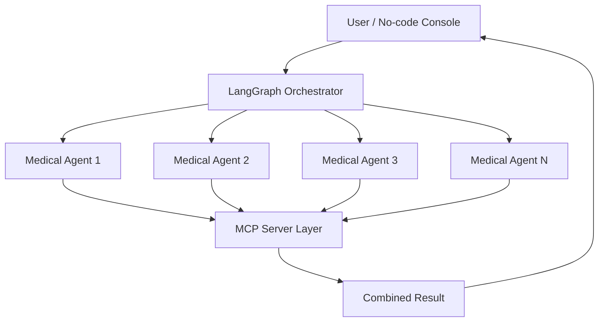
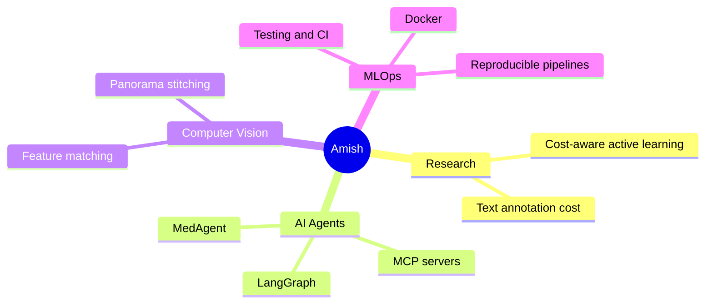

 

  

---

## 👋 About Me

I'm a **B.Tech Computer Science and Engineering student specializing in Artificial Intelligence and Machine Learning at VIT Bhopal (2024–2028)**.

I recently interned in **AI & Data Analytics at Tech Mahindra**, where I worked on LLM-based agentic workflows and enterprise data pipelines.

I enjoy turning machine learning ideas into practical applications through deployed apps, Dockerized jobs, and reproducible experiments.

- 🔬 **Researching:** Cost-aware active learning using uncertainty sampling and knapsack-based sample selection to reduce text annotation costs.
- 🤖 **Building:** MedAgent, an AI agent marketplace powered by LangGraph and MCP.
- 📷 **Exploring:** Classical computer vision, feature matching, and panorama stitching.
- 🤝 **Open to:** AI/ML and software engineering internships, including opportunities in Japan and the Asia-Pacific region.

---

## ⭐ Spotlight: MedAgent

> **Chain medical AI agents into a working pipeline in minutes, without writing code.**

MedAgent provides a no-code interface for composing workflows from reusable AI agents exposed through MCP tools.

### Architecture

**Key features**

- 🧩 Reusable agents exposed as MCP tools.
- 🔗 Multi-agent orchestration with LangGraph.
- 🖱️ No-code pipeline composition.
- 🏥 Support for multiple medical domains.

**Links:** [Live Demo](https://medagent-rust.vercel.app) · [GitHub Repository](https://github.com/Amish23102006/medagent)

---

## 💼 Experience

| Role | Experience |
|---|---|
| **AI & Data Analytics Intern — Tech Mahindra** | **May–August 2026.** Streamlined 3 enterprise data pipelines, reducing manual analysis time by 35%. Designed and integrated 2 LLM-based agentic workflows using LangGraph and MCP, reducing prototype-to-review time by 40%. |
| **Data Science Intern — Finlatics** | **April–June 2026 · Remote.** Applied 5 statistical and ML techniques to multivariable datasets, improving prediction accuracy by 20%, and delivered 3 end-to-end data analysis projects. |

---

## 🚀 Featured Projects

| Project | Description | Technologies |
|---|---|---|
| [**MedAgent**](https://github.com/Amish23102006/medagent) · [Live Demo](https://medagent-rust.vercel.app) | Marketplace connecting 10 AI agents across 6 medical domains. Includes reusable MCP tools and a no-code pipeline builder. | `LangGraph` `LangChain` `MCP` `Node.js` `React` |
| [**Cost-Aware Active Learning**](https://github.com/Amish23102006/cost-aware-active-learning) | Empirical study investigating when cost-aware sample selection outperforms uncertainty sampling for text annotation. | `Python` `scikit-learn` |
| [**Fake Text Detection**](https://github.com/Amish23102006/fake-text-detection) | Classifies AI-generated versus human-written text using stylometric features. Reports approximately 83% accuracy on a held-out, length-matched test set. | `Python` `scikit-learn` `NLP` |
| [**Panorama Stitcher**](https://github.com/Amish23102006/panorama-stitcher) | Command-line panorama stitching pipeline using feature detection, matching, and homography estimation. | `Python` `OpenCV` |
| [**PrimetradeAI-ML**](https://github.com/Amish23102006/PrimetradeAI-ML) | Dockerized MLOps batch job featuring configuration, logging, metrics output, and unit tests. | `Python` `pandas` `Docker` |
| [**Resume Analyzer**](https://github.com/Amish23102006/resume-analyzer-java) | Java Swing mini applicant-tracking system that scores resumes using cosine similarity. | `Java` `Swing` `NLP` |
| [**Open Source Audit**](https://github.com/Amish23102006/open-source-audit) | Git repository auditing toolkit implemented using five Bash scripts. | `Bash` `Linux` `Git` |

---

## 🛠️ Tech Stack

### Languages

### Machine Learning, Data & AI Agents

### Backend, Cloud & Tools

---

## 🎯 Currently Focused On

---

## 🏅 Achievements & Certifications

- 🏆 **Top 10 out of 50 teams** — Health Hackathon 2026, AI healthcare solution.
- 💡 **50+ problems solved** on Codeforces.
- ☁️ **Microsoft Certified: MLOps Engineer Associate (2026).**
- 📚 **Deep Learning Specialization** — Coursera.
- 📚 **Supervised Machine Learning** — DeepLearning.AI.
- 🥋 **Tech Mahindra AI White, Blue & Brown Belt (2026).**

---

## 📊 GitHub Analytics

### 🏆 GitHub Stats

  

### 🔥 Contribution Streak

  

### ⭐ Stars & Followers

  

### 📈 Contribution Activity Graph

  

### 🐍 Contribution Snake

<!--
To display the snake animation, configure the GitHub Actions workflow described below.
Until that workflow is configured, this image will not render.
-->

---

## 📫 Let's Connect

I'm always happy to discuss machine learning, AI agents, MLOps, research, and internship opportunities.

<!-- Add your resume link here when it is publicly hosted. -->

